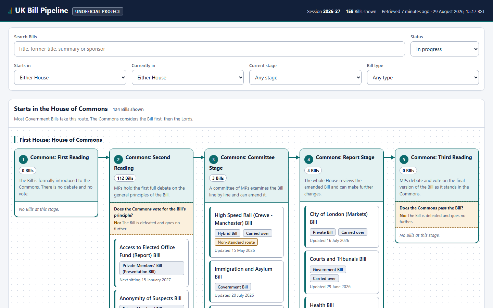
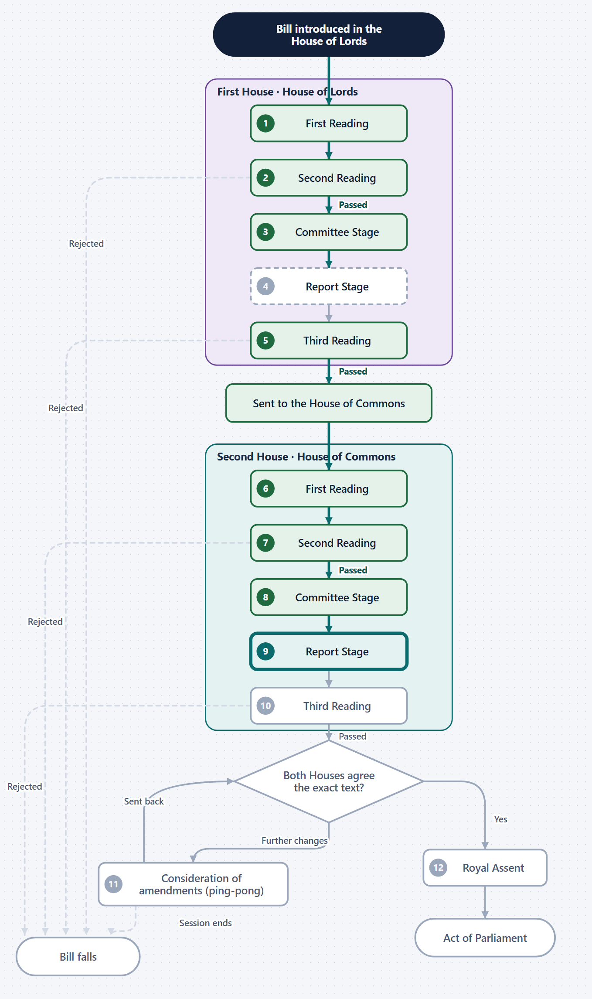
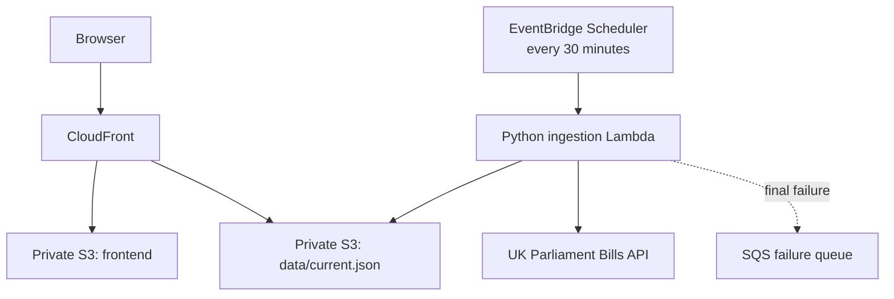

# UK Bill Pipeline

Shows the complete route a Bill can take through the UK Parliament, and where
every Bill in the current session actually sits on it.

> **Unofficial project.** This is an independent project and is not affiliated
> with or endorsed by UK Parliament.



Pick any Bill and you get its own page: the whole route drawn as a flow
diagram, with the path that Bill has actually taken marked on it — including
the votes it passed, the stages it skipped, and where it would have left the
process had it been defeated.



## How it works



A scheduled Lambda reads the Bills API, normalises every Bill onto a fixed
model of the legislative process, and publishes one self-contained JSON
snapshot. A static React frontend reads that file. There is no database, no
request-time backend, and **the browser never contacts Parliament directly**.

Two properties are worth calling out, because most of the design follows from
them:

- **A bad run cannot replace a good snapshot.** If the source is empty,
  incomplete, implausibly smaller, or fails schema validation, the run fails
  and the previous snapshot keeps serving.
- **Unrecognised input is shown, not guessed at.** A stage this build does not
  know is published as `unknown` with its real name attached, and the Bill
  appears in an explicit unclassified section. Stages are matched on numeric
  id, never on their description.

[`docs/architecture.md`](docs/architecture.md) explains the reasoning;
[`docs/process-model.md`](docs/process-model.md) is the Mermaid model the
diagram is drawn from.

## Getting started

```bash
make install     # Python venv and npm ci
make dev         # Vite against a synthetic snapshot, no AWS or internet needed
```

The checked-in `frontend/public/data/current.json` contains invented Bills, is
marked `synthetic`, and the running app labels it "Example data". It exists so
a new contributor can work offline.

```bash
make check       # everything below, and what CI runs
make lint        # ruff, mypy strict, ESLint, tsc, prettier
make test        # backend pytest and frontend vitest
make test-e2e    # Playwright against the production build, including axe
make tf-validate # terraform fmt, validate, and the static policy checks
make tf-test     # Terraform policy tests, mocked providers, no credentials
```

Nothing above needs AWS credentials.

Two commands talk to the live Bills API, and neither publishes anything:

```bash
python scripts/live_smoke.py            # a real ingestion, into memory
python scripts/live_smoke.py --out s.json
```

## Deploying

**Deploying is optional.** Everything above runs, tests and builds without an
AWS account, and the CI workflow needs no credentials. If you only want to
read the code or run it locally, you can stop here.

If you do want it hosted: an AWS account, Terraform, and about ten minutes.
[`docs/deployment.md`](docs/deployment.md) has the full sequence, including
the two things that commonly stop a first apply (Lambda concurrency quotas and
the EventBridge Scheduler trust policy) and how to attach a custom domain when
DNS is hosted outside Route 53.

[`docs/operations.md`](docs/operations.md) covers running it: updating the
session at rollover, reading the logs, the failure queue, recovering a
previous snapshot, and responding to a stage id Parliament has just invented.

## What you have to configure, and what you can leave out

The stack is built to be taken apart. **Two variables are required**;
everything else has a default that produces a complete, working deployment.

```hcl
parliament_session_id    = 40      # verify before every apply
parliament_session_label = "2026-27"
```

That alone gives you the site on a `*.cloudfront.net` hostname, scheduled
ingestion, a failure queue and four alarms. Each feature below is off until
you switch it on, and leaving it off creates nothing rather than creating
something disabled:

| Optional | Switch | Leaving it off means |
| --- | --- | --- |
| Custom domain | `domain_name` | The CloudFront hostname, which works fine |
| Route 53 DNS | `hosted_zone_id` | You add two records at your own DNS provider |
| Alarm emails | `alarm_email` | Alarms still exist and still show state; nobody is emailed |
| Budget alerts | `budget_alert_email` | No AWS Budget. A budget alerts, it is not a cap |
| Access logs | `enable_cloudfront_access_logs` | No per-request log; CloudFront metrics still work |
| A state bucket | apply `infra/bootstrap` | Point `backend.hcl` at a state bucket you already run |
| Deployment from CI | `AWS_DEPLOY_ROLE_ARN` variable | The deploy job is **skipped**, not failed; quality checks still run |

Two more worth knowing: `ingestion_enabled = false` pauses the pipeline
without destroying anything, and `lambda_reserved_concurrency = null` is
**required** on an account whose Lambda quota is 10.

[`infra/README.md`](infra/README.md) is the full reference — every variable,
what each optional feature creates, and the short list of things that are
deliberately *not* configurable because they are guarantees rather than
preferences (private buckets, no bucket listing on the ingestion role, no
NAT Gateway or database, and publication guards that cannot be disabled).

## Continuous integration

[`ci.yml`](.github/workflows/ci.yml) runs on every pull request and needs no
AWS credentials: ruff, mypy, pytest, ESLint, tsc, vitest, Playwright with axe,
`terraform fmt`/`validate`, 34 Terraform policy tests against mocked
providers, TFLint, a Trivy configuration scan, and checks that the licence
attribution is still present.

[`deploy.yml`](.github/workflows/deploy.yml) calls that same workflow as its
gate, then deploys — but only if `AWS_DEPLOY_ROLE_ARN` is set. It federates
through GitHub OIDC for short-lived credentials, so **there are no stored AWS
keys**, and it is unreachable from `pull_request`, so a fork's pull request
cannot assume the role. Third-party actions are pinned to commit SHAs.

## Cost

The design target is **effectively £0 a month** at demonstration traffic,
excluding a domain or a Route 53 hosted zone.

That is a target, not a promise, and nothing here can stop AWS charging. What
keeps it low is what the design leaves out: no NAT Gateway, no VPC endpoints,
no API Gateway, no database, no customer-managed KMS key, no provisioned
concurrency, no always-on environment. Logs, archives and object versions all
expire. An optional AWS Budget can send alerts — a budget alerts, it is not a
cap.

## Known limitations

**The session is configuration.** The Bills API has no dependable
current-session lookup, so `parliament_session_id` is set explicitly and must
be updated at each State Opening. A canary detects a stale value and fails the
run rather than publishing a session that has ended. See
[operations](docs/operations.md#updating-the-parliamentary-session).

**Not every Bill fits the model.** Private and Hybrid Bills have examination
stages the twelve-stage route cannot represent; some Bills are at procedural
stages that anchor back to an earlier stage. These are shown in an explicit
unclassified section with the reason on the card, rather than being forced
onto a stage they are not at.

**The data is up to 30 minutes old**, and the page says so. It is a snapshot,
not a live feed.

**"Defeated" means only that the API says so.** A Bill that has been quiet for
months is still shown as in progress, because the API exposes no reliable
lapsed flag and inferring one would be guesswork.

**One session, no history.** The snapshot covers a single configured session.

## Data, licensing and attribution

Bill data comes from the [UK Parliament Bills API](https://developer.parliament.uk/).

> Contains Parliamentary information licensed under the
> [Open Parliament Licence v3.0](https://www.parliament.uk/site-information/copyright-parliament/open-parliament-licence/).

**The two licences do not overlap.** [`LICENSE`](LICENSE) is MIT and covers
this project's own software and assets. It does **not** cover Parliamentary
information, which stays under the Open Parliament Licence — including the
published snapshot and any test fixture derived from real API responses.
[`THIRD_PARTY_NOTICES.md`](THIRD_PARTY_NOTICES.md) sets out the boundary.

No Parliamentary imagery is used. The Crowned Portcullis, the Royal Arms, UK
Parliament logos and wordmarks, and Parliamentary photography are **not**
covered by the Open Parliament Licence, so none appears here. Member
photograph URLs returned by the API are discarded during normalisation and are
never published or proxied — the site renders no `` element at all.

The concept was inspired by TLDR News's
[How Bills Get Passed in Parliament (and why it takes so long)](https://www.youtube.com/watch?v=pLSE3O5OaBo).
No TLDR News material is used: the wording, layout, colour system, typography
and diagrams here are original work. Credit is not permission to copy, so
nothing was copied.
