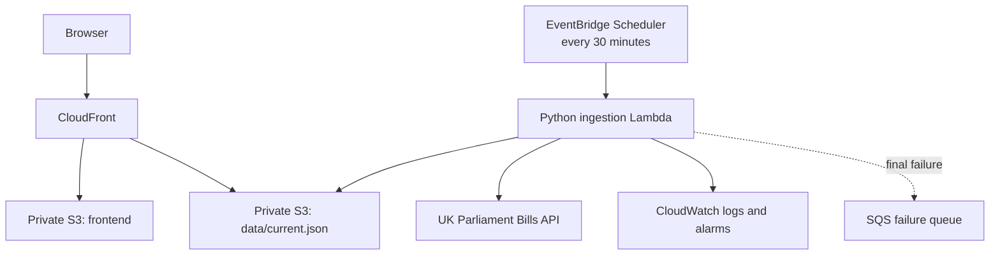

# Architecture

## The shape of it

There is no database, no request-time backend, and no always-on compute. A
scheduled job produces one file; a CDN serves it. Everything below follows
from that.

## Why a snapshot instead of an API

The obvious design is a small API that proxies the Bills API. This project
does not do that, for four reasons.

**Read volume is decoupled from source load.** The Parliament API is a free
public service. A proxy makes every visitor a request to it; a snapshot makes
the load a fixed two calls per minute regardless of how many people are
looking. Bounded, predictable load on someone else's service is the polite
design as well as the cheap one.

**The failure modes get much better.** A proxy is only as available as its
upstream. A snapshot keeps serving the last known-good data when the source
is down, slow, or returning something malformed. The
[publication guards](#publication-guards) make that a guarantee rather than a
hope.

**Normalisation happens once.** Mapping stage ids onto a process model,
anchoring ancillary stages, counting ping-pong exchanges: doing that per
request would be wasted work and would put the mapping rules on the hot path.
Doing it once, off to the side, means the browser receives data that is
already in the shape it needs.

**Cost.** A static file behind a CDN has no idle cost. An API Gateway plus a
request-time Lambda has a per-request cost and a great deal more to go wrong.

The trade is freshness: the data is up to 30 minutes old, and the UI says so
rather than implying it is live.

## Why the browser never contacts Parliament

The frontend only ever fetches `/data/current.json` from its own origin.

This is partly courtesy, as above. It is also about honesty and control: the
browser gets exactly the data the ingestion function validated and published,
so what the page renders is what the guards approved. If the browser called
the API directly there would be a second, unvalidated path into the UI with
different failure modes and no schema check.

It also means no CORS, no API key handling in client code, and a content
security policy that can forbid every third-party origin outright.

## Why two buckets

The frontend and the generated data live in separate S3 buckets.

Deploying the frontend runs `aws s3 sync --delete` against the site bucket.
That command must be structurally incapable of deleting the published
snapshot. Separate buckets make it so — not by convention or by a careful
`--exclude`, but because the snapshot is not in the bucket being synced.

The same split shows up in IAM. The ingestion function's role can name only
two key patterns in the data bucket. It has no permission on the site bucket
at all, so a fault in ingestion cannot damage the site, and no `s3:Delete` or
`s3:ListBucket` anywhere.

Both buckets are private, use the regional S3 REST endpoint rather than
website hosting, and are readable only by this CloudFront distribution
through Origin Access Control conditioned on the distribution's exact ARN.

## Cache and freshness

Three classes of object, three cache policies:

| Object | `Cache-Control` | Why |
| --- | --- | --- |
| Fingerprinted JS and CSS | `public,max-age=31536000,immutable` | The filename changes when the content does, so it can never be stale. |
| `index.html` and root files | `public,max-age=0,must-revalidate` | It points at the fingerprinted assets, so it must always be current. |
| `data/current.json` | `public,max-age=60,s-maxage=300,must-revalidate` | Browsers revalidate after a minute; the CDN holds it for five. |

Because the data has a short TTL, a routine refresh needs no CloudFront
invalidation. The deployment workflow invalidates only `/` and `/index.html`,
and never `/*`.

The frontend fetches with `cache: 'no-cache'`, treats a live snapshot older
than three hours as stale, and says so in a non-blocking banner while still
showing the data. It also keeps the last valid snapshot in local storage and
falls back to it if the network fails, labelled clearly as cached.

## Incremental refresh

A full fetch of every Bill's detail and stage history is a few hundred
requests. Doing that twice an hour, forever, would be rude.

Each run instead:

1. reads and validates the previously published snapshot;
2. fetches the complete session list, the Bill types and the stage catalogue;
3. compares each Bill's `lastUpdate` against the cached copy, byte for byte;
4. fetches detail and history only for Bills that are new, changed, or whose
   cached record is incomplete;
5. reuses the validated cached record for everything else.

A typical run costs the list plus a handful of detail fetches. Once a week it
reconciles everything regardless, so cached records cannot drift indefinitely.

`lastUpdate` is compared as an exact string. The API emits it without a
guaranteed UTC offset, so parsing it into an instant would be inventing
information; comparing it verbatim is both safer and sufficient.

Bills carried forward unchanged still get `nextSittingDate` recomputed,
because that field is relative to today rather than to the source.

## Atomic publication

`data/current.json` is written last and written whole. Replacing an S3 object
is atomic for readers, so a browser sees either the previous complete
snapshot or the new complete one, never a half-written file.

Before that, if the content hash changed, an immutable copy is written to
`archive/snapshots/<hash>.json`. The key is content-addressed, so an
at-least-once duplicate invocation writes an object that already exists
rather than a duplicate. Reserved concurrency of one on the function makes
concurrent runs impossible in the first place.

The hash covers the source-derived content and excludes the two generated
timestamps and `nextSittingDate`. That last exclusion is deliberate:
`nextSittingDate` moves with the calendar rather than with Parliament, so
including it would produce a fresh archive object every day even when nothing
had been published.

`current.json` is rewritten on every successful run even when the content is
unchanged, so the freshness indicator stays honest on a quiet weekend.

## Publication guards

The property that matters most is that a bad run cannot replace a good
snapshot. Publication is refused when:

- pagination did not retrieve exactly the advertised number of unique Bills;
- the result is empty for a session that should be live;
- the Bill count fell by more than 30% while the session id was unchanged;
- any new or changed Bill could not be fully normalised;
- the assembled document fails JSON Schema validation;
- the rollover canary reports a session newer than the configured one.

In every case the run fails, the alarm fires, and the previous snapshot keeps
serving.

An unrecognised stage id is explicitly *not* a guard failure. It is normal
input: the Bill is published as `unknown`, the raw stage label is retained,
and warnings appear both in the snapshot and in the logs. Refusing to publish
because Parliament added a stage would be a self-inflicted outage.

## Session configuration

The Bills API has no dependable "current session" lookup, so the session is
explicit deployment configuration rather than something inferred at runtime.
Guessing from the calendar or scraping an HTML page would both be fragile in
ways that fail silently.

To catch a stale configuration, each run asks for the single most recently
updated Bill across all sessions. If it reports a session newer than the
configured one, the run logs a critical configuration warning and fails
without republishing. See [operations](operations.md) for the fix.

## Security posture

- Both buckets: all Block Public Access settings on, `BucketOwnerEnforced`,
  SSE-S3, versioned, and a policy denying anything not over TLS.
- CloudFront is the only public entry point, reaching S3 with SigV4 through
  Origin Access Control. Only `data/*` is exposed; `archive/*` stays private.
- The ingestion function is not in a VPC. It talks to one public API and to
  S3, so a VPC would add a NAT Gateway — the largest avoidable cost in the
  design — for no security benefit.
- The source API host is configuration, never event input. Accepting a URL
  from a Scheduler payload would turn the function into a server-side request
  forgery primitive. The HTTP client also pins the host and refuses any
  redirect that leaves it.
- There are no application secrets, so there is no secret store and no KMS
  key.
- Deployment uses GitHub OIDC. There are no long-lived AWS keys.

## Cost

The design target is effectively nothing per month at demonstration traffic,
excluding a domain or hosted zone. It is a target, not a guarantee, and
nothing here can stop AWS charging.

What keeps it there: no NAT Gateway, no VPC endpoints, no API Gateway, no
database, no customer-managed KMS key, no provisioned concurrency, no
always-on duplicate environment, and short retention on logs, archives and
object versions. A monthly AWS Budget can be enabled to send alerts, but a
budget alerts — it is not a cap.

## Trade-offs taken knowingly

**Freshness for resilience and cost.** Up to 30 minutes stale, stated
plainly in the UI.

**One session, not history.** The snapshot covers a single configured
session. Comparing sessions would need a different data model.

**A model of the process, not the whole of it.** Twelve canonical stages
cannot represent every procedure. Rather than stretch the model, Bills that
do not fit are shown in an explicit unclassified section with the reason on
the card. See [the process model](process-model.md) and
[the stage mapping](stage-mapping.md).

**Client-rendered.** No server-side rendering, so the first paint needs
JavaScript. In exchange the whole site is static files, and the underlying
data stays a single documented JSON file anyone can fetch.
