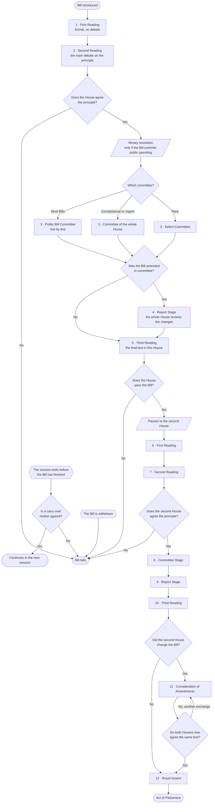

# The process model

This is the model the flow diagram is drawn from. It is the design source for
`frontend/src/model/routes.ts`: if the two ever disagree, this document is
what should be argued about first and the code changed to match.

It describes the passage of a Public Bill as set out in Parliament's own
guidance. It is deliberately a model, not a complete account of procedure —
the notes at the end record what is left out and why.

## The full route

## What each shape means

| Shape | Meaning | Holds Bills? |
| --- | --- | --- |
| Rounded terminal | A start or end state | No |
| Rectangle | A numbered stage on the route | Yes |
| Parallelogram | A procedural step that runs alongside the route | No |
| Diamond | A decision that can send the Bill more than one way | No |
| Hexagon | Something that can happen at any point, not at one step | No |

The twelve numbered rectangles are the only places a Bill is ever counted.
That is what keeps the counts on the main chart and the sections it renders
in agreement: every Bill is at exactly one numbered stage, or is explicitly
unclassified.

## Decisions the model makes deliberately

**Committee type is a real branch, not a footnote.** The API distinguishes a
Public Bill Committee (stage 8) from a Committee of the whole House (49) and
a Select Committee (43). All three normalise to the same numbered stage, so a
Bill is still counted once, but the branch is drawn because which committee a
Bill goes to is a genuine decision with visible consequences.

**Report stage can be skipped.** A Bill that came out of committee unamended
can go straight to third reading. Drawing report stage as unconditional would
make a Bill that skipped it look as though it had gone missing.

**Ping-pong is a loop.** Consideration of amendments is not one step the Bill
passes through; it is an exchange that repeats until the two Houses agree.
The published snapshot counts the exchanges, so the diagram can say which one
a Bill is currently in.

**Ending early is not a stage.** Withdrawal and running out of session time
can happen at almost any point. Drawing them as boxes on the route would
imply an order they do not have, so they hang off the side.

## What is left out, and why

- **The Parliament Acts.** The Commons can in principle pass a Bill without
  the Lords' agreement. It has happened a handful of times in a century, and
  the Bills API does not model it, so including it would add a path that is
  never taken in the data.
- **Private Bills and Hybrid Bills.** These have their own examination stages
  before the route proper. The published snapshot marks them as following a
  special procedure rather than pretending they fit here.
- **Lords Grand Committee and Special Public Bill Committee.** Both normalise
  to the Lords committee stage. They are shown by name on the Bill's own
  page, but they are not separate branches on the chart.
- **Commencement.** An Act is not necessarily in force on the day it receives
  Royal Assent. That is beyond what the Bills API describes.
- **Amendment content, votes and speeches.** Out of scope for the first
  release, as recorded in the specification's non-goals.
